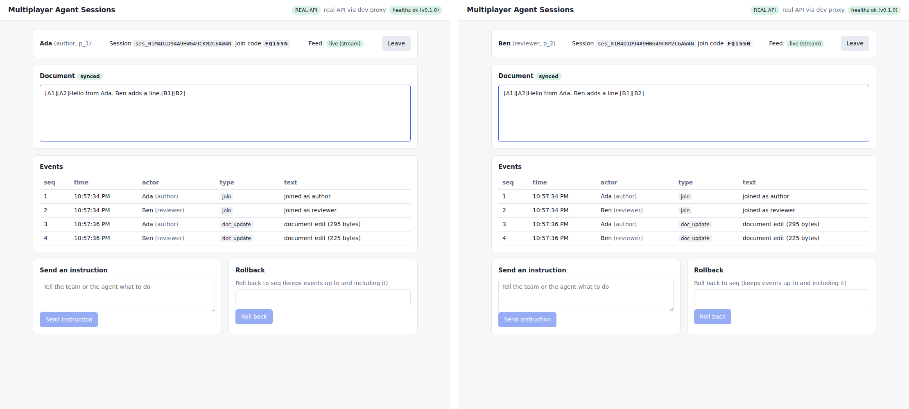
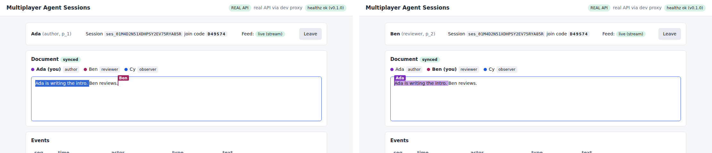
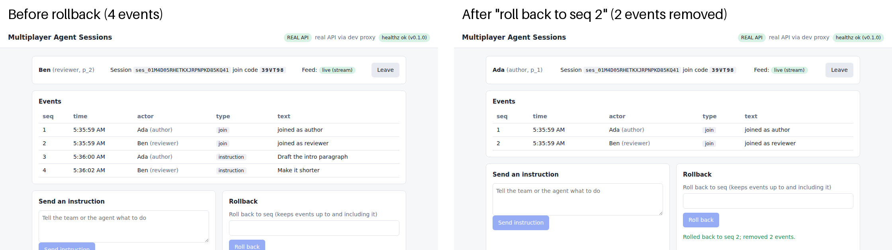
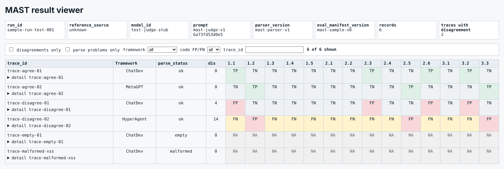
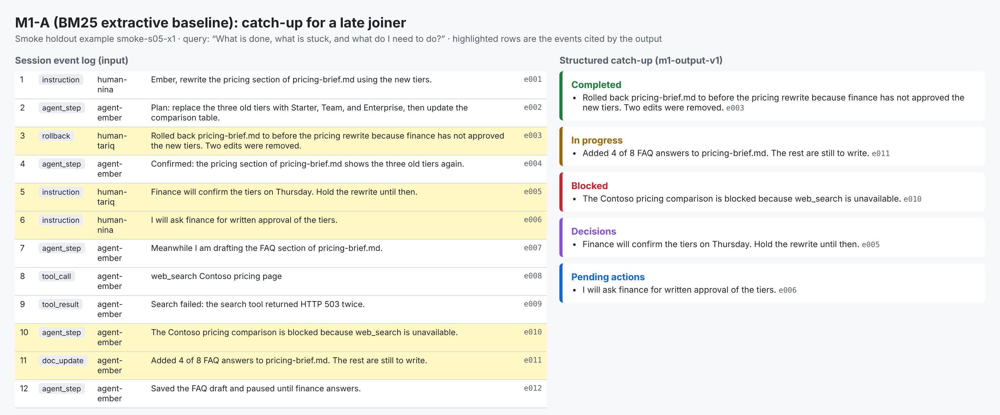

# Demo Images

These screenshots show the Multiplayer Agent Sessions client working with the real session
service, plus two tools for the MAST baseline and the M1 catch-up task. The client runs
against the real session service (look for the REAL API badge), but model outputs are not
integrated into the client yet.

## Real-time collaborative editing

- Ada (author) and Ben (reviewer) are in one session and edit the same document at the same
  time. The left tab is Ada and the right tab is Ben, and both show the same text.
- Edits merge automatically. This uses a Yjs CRDT through our crdt-server, so nobody's
  changes are lost.
- Each edit is also saved to the session event log as a `doc_update` event. Events 3 and 4 in
  the table are these two edits.
- The REAL API badge in the header means the client is talking to the real session service,
  not to the mock.

## Presence and roles

- Three people are present: Ada (author), Ben (reviewer) and Cy (observer). The bar above the
  document lists each one with a colour dot and their role.
- Each person's cursor and selection show in the editor with their name, in their colour. In
  the left tab (Ada) you can see Ben's cursor. In the right tab (Ben) you can see Ada's
  selection.
- A person keeps the same colour after rejoining.
- Observers can read the document but cannot edit it.

## Shared event log and rollback

- Left: the session has 4 events, two joins and two instructions ("Draft the intro
  paragraph" and "Make it shorter").
- Right: after "roll back to seq 2", the two instructions are removed and only the two joins
  remain. The page confirms "Rolled back to seq 2; removed 2 events."
- Every action in a session is an ordered event in one shared log, so the removal applies to
  everyone in the session. This log is also what the M1 catch-up model will read.

## MAST result viewer

- Each row is one trace and each column is one failure code. A cell compares the judge's
  label with the reference label: TP (both say yes), FP (the judge says yes, the reference
  says no), FN (the judge says no, the reference says yes) and TN (both say no). NA means the
  judge's response could not be parsed, as in the empty and malformed rows.
- The header shows the run, the frozen prompt version and hash (`mast-judge-v1`,
  `6a73fd53d0e5`), the parser version and the eval manifest version.
- Important: this screenshot uses a 6-record test fixture with a stub judge. It is not a real
  MAST result. The real o1 judge run is still pending. The parser version and reference source
  in the header (`mast-parser-v1`, `unknown`) come from that fixture.

## M1-A catch-up baseline

- Left is a session's event log, which is the input. Right is the catch-up that M1-A produces
  for a late joiner, sorted into completed, in progress, blocked, decisions and pending
  actions.
- Every line on the right is copied from one event and names that event (for example `e003`).
  Those cited events are the highlighted rows on the left.
- M1-A is a simple, transparent BM25 baseline that learned models must beat. It is in draft
  PR #26.
- Important: this is a synthetic smoke example. It shows the output format, not model quality.

## What is not shown yet

There is no M1 or M3 model output in the client yet, and there are no real MAST judge results
yet.
